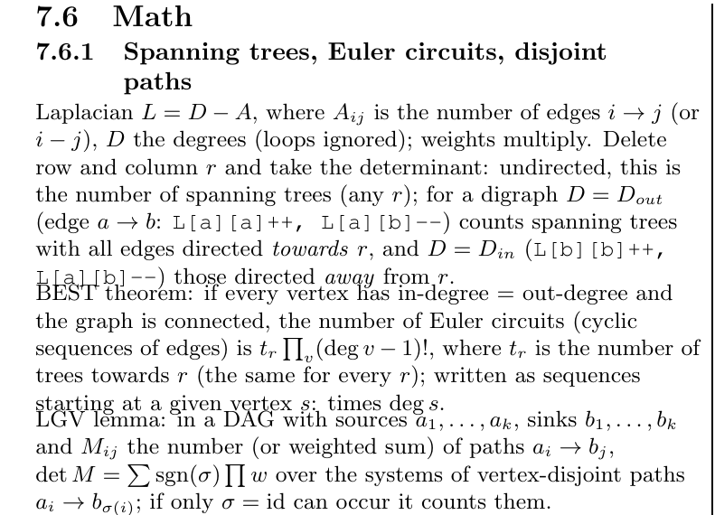
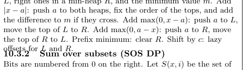
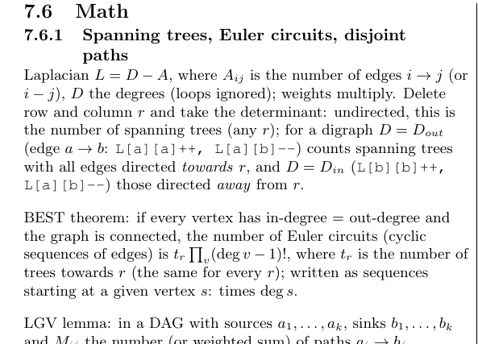
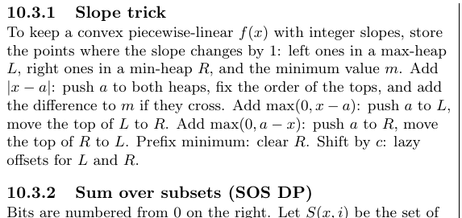
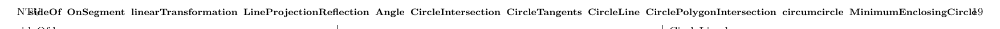
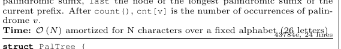
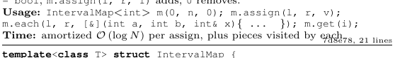
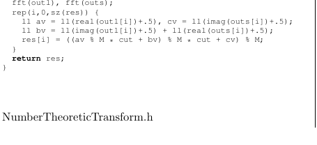
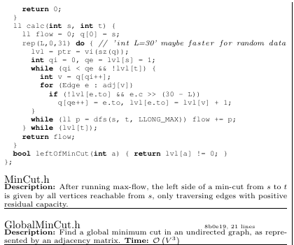

# Overnight report (2026-11-09)

Three jobs: (1) item 18, tests for the gaps; (2) look for errors in `kactl.pdf`; (3) experiments to save space.
The book itself is **unchanged** (only tests and the hidden `Status:` lines were committed). Everything else is a
measured experiment, packaged as a patch in `diffs/` that applies to the current branch with `git apply`.

## TL;DR

- **Tests (item 18): done.** 22 new stress tests, so every printed code file is now tested through its real header.
  `make test` 133/133 and `make test-compiles` 155/155, both also with `LLINT=1`. No bug found in the library.
- **The PDF has real layout bugs:** overlapping lines in three places (pages 19 and 25), the page 20 header
  running into "NTU" and the page number, two `Time:` lines running into the hash, and 3 file titles stranded at
  the bottom of a column. **`diffs/01-layout-fixes.diff` fixes all of them and stays at 26 pages.** Recommended.
- **Space:** the biggest savings come from the format, not the content. Two combinations reach **25 pages**:
  - `10-combined-25-pages-layout-only.diff`: 25 pages, 105pt (about 0.2 column) spare. No content changes.
  - `11-combined-25-pages-roomier.diff`: 25 pages, 336pt (0.6 column) spare. Patch 10 plus 17 shorter descriptions.
  - With every patch except removing blank lines in code: 25 pages, 1.2 columns spare. With that too: 2.4 columns spare.
- **62 code lines are wider than 63 characters** and wrap onto 2 lines in the PDF. All of them come from this season's
  edits. `12-unwrap-code-lines.diff` shortens 27 of them to fit (all tests pass); the list is in `wrapped-code-lines.txt`.

One column is about 556pt (about 72 code lines). "Saved" below is measured, not estimated (method at the end).

---

## 1. Item 18: tests for the gaps

The audit followed the `#include`s of every stress test. 26 printed code files had no test that included the real
header, and 4 more were only tested through old pasted copies of the code. The copies differ a little from the
printed code: `SolveLinear`, `IntDeterminant`, `SolveLinearBinary` and `SolveLinear2`.

New tests, all comparing against brute force, in both modes:

| Area | Tests |
|---|---|
| numerical | `MatrixInverse`, `MatrixInverse-mod`, `Determinant`, `Polynomial`, `PolyInterpolate`, `Integrate`, `HillClimbing`; `SolveLinear.cpp` and `IntDeterminant.cpp` now also test the real headers |
| graph | `BiconnectedComponents`, `CompressTree`, `GeneralMatching` |
| data structures | `HashMap`, `OrderStatisticTree`, `Matrix` (also with `mint`) |
| other | `Manacher`, `DivideAndConquerDP`, `IntervalCover`, `TernarySearch`, `phiFunction`, `multinomial`, `linearTransformation`, `kdTree`, `Angle` |

- **Mutation check:** 69 hand-made bugs were planted in the headers, and 66 were caught. The other 3 change nothing
  observable: the empty case of `multinomial`, the child order in `kdTree` (only affects speed), and `x <= 0` in
  `Angle::half` (only differs at the origin, which asserts anyway). The first round missed 3 real bugs, so the
  `HillClimbing`, `Manacher` and `Angle` tests were strengthened until they caught them.
- **Not testable:** `MinCut` and `MaximumIndependentSet` are text only, and `SolveLinear2` is a snippet. The contest
  scripts already have `doc/scripts/test-contest-scripts.sh`.
- **Things worth knowing that came up:**
  - `GeneralMatching.h` needs `MatrixInverse-mod.h` (40 lines), which is **not printed**. The original KACTL has
    the same gap. Either print it or note it.
  - `DivideAndConquerDP.h` stores the cost in a `pii`, so it truncates without `#define int long long`.
  - `Angle`'s `operator+` asserts if the sum is the origin.
  - `IntervalCover` returns an empty result for an empty target range.

## 2. Errors in the PDF

Checked with `layout-check.py` (in this folder; run `python3 doc/overnight-2026-11-09/layout-check.py kactl.pdf`),
by eye at 150 dpi, and in the LaTeX log.

### 2.1 Overlapping lines in text sections (real bug, inherited from KACTL)

Page 19, graph "Math": the "BEST theorem" and "LGV lemma" lines are drawn on top of the line above.

Page 25: "offsets for L and R." collides with "10.3.2 Sum over subsets". The same happens before "10.5.1 Bit hacks".

**Cause.** `kactlpkg.sty` (from upstream KACTL) gives `\subsection` the skip `1ex plus -1ex minus -.3ex`, which
has *negative* stretch. `multicols` stretches every column to full height. In a column with text paragraphs and
subsections, that negative stretch makes some gaps shrink below zero (lines overlap) and others grow huge. It also
caused the 114pt hole at the bottom of page 18. (The original KACTL has few subsections followed by text, which is
probably why it went unnoticed there.)

**Fix (in patch 01).** Use `-1ex plus -1ex minus -.3ex`, the usual LaTeX idiom: a negative value means "this
amount, and no indent after". Result: no overlaps, and the hole on page 18 shrinks from 114pt to 40pt.

`\raggedcolumns` (no column stretching at all) also fixes the overlaps. It is an alternative if you prefer ragged
column bottoms, but it does not fix the page 18 hole.

### 2.2 Page 20 header runs into "NTU" and the page number

The preprocessor shrinks long headers only to 8pt, and page 20's list is 165 characters. **Fix (patch 01):**
10pt up to 120 characters, 8pt up to 150, 7pt above that.

### 2.3 `Time:` lines running into the hash

`PalindromicTree.h` and `IntervalMap.h` (both ours). **Fix (patch 01):** shorter wording, "O(N) amortized, for a
fixed alphabet" and "... plus the pieces visited".

### 2.4 File titles stranded at the bottom of a column

`LazySegTreeBlock.h` (p3), `NumberTheoreticTransform.h` (p8) and `SuffixArray.h` (p23) sit alone at the bottom of a
column, with their description and code on the next one.

**Cause.** `listings` puts a page break bonus (`\penalty-50`) and an `\allowbreak` at the start of every listing,
which is right after our title. **Fix (patch 01):** two `\patchcmd`s turn those into "no break", plus `\nobreak`
after the title.

Side effect: in two places (2sat on p16, LCA on p17) TeX now splits the description itself, leaving the `Time:` and
hash line at the top of the next column with the code. That reads fine.

Making the whole description unbreakable was also tried, and it costs a full page (27 pages, with section headings
stranded instead). Rejected.

### 2.5 Space lost at column breaks

To measure this I built the book with ragged columns and added up the empty space at each column bottom. It totals
about **700pt (1.25 columns)** over pages 2 to 25. Most of it is unavoidable with this layout, because a heading needs
2 lines after it and a description never splits from its title. The biggest gaps (after patch 01):

| Where | Free | What did not fit |
|---|---|---|
| p8 col 2 | 61pt | `NumberTheoreticTransform.h` (title + long description) |
| p24 col 2 | 50pt | section "Suffix array and automaton facts" |
| p15 col 1 | 47pt | `WeightedMatching.h` |
| p3 col 1 | 46pt | `LazySegTreeBlock.h` (huge description) |
| p25 col 1 | 43pt | "Slope trick" |
| p23 col 2 | 43pt | `SuffixArray.h` |
| p18 col 3 | 40pt | section "Math" (was 114pt before the fix) |

Shorter descriptions on those files (NTT, LazySegTreeBlock, SuffixArray, WeightedMatching) shrink these gaps
directly.

### 2.6 Wrapped code lines

62 printed code lines are longer than 63 characters (counting a tab as 2), so `breaklines` wraps each one onto 2
lines. By file: `LazySegTree` 7, `HalfPlane` 6, `LiChao` 5, `SuffixAutomaton` 4, `PalindromicTree` 4,
`SolveLinearMod` 4, `ExLucas` 4, `PolyOps` 3, `LagrangeInterpolation` 3, `DsuOnTree` 3, `RectangleUnion` 3,
`DynCon` 3, and 1–2 in 10 others. Full list with lengths: `wrapped-code-lines.txt`.

By length: 14 lines are 64–66 characters, 22 are 67–70, and 26 are over 70. Even the original KACTL files on the list
(`MinRotation`, `SuffixArray`, `MaximumClique`) only got too long because of our `max<int>` edits for
`#define int long long`.

**Patch 12** shortens 27 of them to 63 characters or less by dropping a few spaces or a word in a comment. Examples:
`int o = 1, int lo = 0` becomes `int o=1, int lo=0`, and `query(l, r, 2*o, lo, m)` becomes `query(l,r,2*o,lo,m)`. It
saves 240pt (0.4 column) and touches 15 files, so their hashes change. On the patched code `make test` passes 133/133
and `make test-compiles` 155/155, both also with `LLINT=1`. The other 35 lines need a real rewrite; splitting them by hand gives the same number of
lines as the automatic wrap, but with proper indentation.

### 2.7 Clean

- 0 overfull boxes.
- No text past a column edge.
- No other overlapping words.
- The remaining hits of `layout-check.py` are sub/superscripts and the labels inside the geometry figures.

## 3. Space experiments

### Method

Build the book with `\raggedcolumns` and add up the natural height of the content in every column (`U`, in pt).
Unlike the page count or the free space at the end, `U` drops by exactly the space a change saves, wherever in the
book the saving happens. Baseline: patch 01 applied, `U = 39094`pt for pages 2–25. One column is about 556pt.

| # | Change | Saved | Columns | Notes |
|---|---|---:|---:|---|
| 02 | Hash and line count on the title line instead of a tiny line under the description (image below) | 305 | 0.55 | Only files with includes keep the tiny line, for the include list |
| 03 | Listing spacing: `aboveskip` 3→1pt, `belowskip` 2→0pt, `framesep` 1pt | 818 | 1.5 | The rule over the code moves closer to the description; looks fine |
| 04 | `Time:` at the end of the description paragraph, when the file has no `Usage:` | 268 | 0.5 | Saves the partly empty last line of most descriptions |
| 05 | Smaller headings: section `\LARGE`→`\Large`, subsection `\large`→`\normalsize`, compact TOC, chapter `\huge`→`\LARGE` | 223 | 0.4 | Sum of the three, measured separately |
| 06 | Column gap 10→6pt | 68 | 0.1 | Columns 2.7pt wider; descriptions rewrap |
| 07 | Techniques in the same flow as the rest (no forced new page) | 0 by itself | | Lets the leftover space of the last body page and the techniques page pool together. This is what makes 25 pages reachable |
| 08 | No blank lines inside code (`emptylines=*0`) | 751 | 1.35 | Biggest single item, but blank lines between functions help reading. Hashes are unchanged (whitespace is ignored) |
| 09 | Shorter wording for 17 long descriptions (same facts; script `shorter-descriptions.py`) | 262 | 0.5 | About 2 lines per file. Needs team review. Doing this for more files would give more |
| 12 | Shorten 27 code lines that wrap (section 2.6) | 240 | 0.4 | Code change; all tests pass in both modes |
| | Margins 0.5→0.4cm left/right | 27 | 0.05 | Not worth the printing risk |
| | Top margin 1.0→0.8cm | about +400 capacity | 0.7 | Header would be 3.5mm from the paper edge; printer risk |
| | File titles `\large`→`\normalsize` | 13 | 0 | Not worth it |
| | Drop the 8 small geometry figures (text gets full width) | 84 | 0.15 | Not worth losing the figures |
| | Code font `\footnotesize`→`\scriptsize` | **2 pages** (24 total) | | Big, but code gets noticeably smaller; compare `img/code-footnotesize.png` and `img/code-scriptsize.png` on paper first |
| | 4 columns | **2 pages** (24 total) | | 32 overfull boxes (tables, formulas, `\verb` lines), and every code line over about 48 characters wraps (572 lines). Not recommended |
| | 4 columns + `\scriptsize` code | 4 pages (22 total) | | Same problems, smaller. Not recommended |
| | Make descriptions unbreakable | **costs a page** (27) | | Rejected |

Patch 02 looks like this. The right column shows `GlobalMinCut.h` with the hash on its title line and `Time:` inline
(patch 04):

### Combinations (all verified: built, 0 overfull boxes, no overlaps)

| Patch | Contents | Pages | Spare at the end |
|---|---|---:|---|
| 01 | Bug fixes only | 26 | as now (about 0.6 column on the techniques page) |
| 10 | 01 + 02 + 03 + 04 + 05 + 06 + 07 | **25** | 105pt (0.2 column) |
| 11 | 10 + 09 (shorter descriptions) | **25** | 336pt (0.6 column) |
| | 11 without 07, plus 08 (no blank lines in code) | **25** | 857pt after the body + 368pt on the techniques page |
| | 01–07 + 09 + 12 (everything except 08) | **25** | 662pt (1.2 columns) |
| | 01–09 + 12 (everything) | **25** | 1345pt (2.4 columns) |

A full page for comparison: `img/current-page15.png` (now) and `img/patch10-page15.png` (patch 10, which starts
one file later because everything before it got shorter).

## 4. Suggested order

1. **Apply 01** (`git apply doc/overnight-2026-11-09/diffs/01-layout-fixes.diff`). It fixes the four bugs, changes
   no content, and stays at 26 pages.
2. Look at 02, 03 and 04 (the format of each file block). Printing one page of patch 10 is the quickest way to judge.
   If you like them, apply **10** instead of 01; it contains 01. That gets back a page with no content changes.
3. Review the wording in 09 (the diff shows old and new side by side; `shorter-descriptions.py` has just the new
   texts). It is easy to extend to more files, and the long descriptions also cause the biggest column-break gaps.
4. Apply 12 (shorter code lines) if the slightly tighter spacing in those 27 lines is acceptable. It needs nothing but
   a rebuild, since the tests already pass.
5. 08 (no blank lines) and `\scriptsize` code are the big reserves if more room is ever needed.

Patch 01 applies to the branch as it is now. Patches 02–09 and 12 are written on top of 01, so apply 01 first. After
that they apply in any order and in any combination (every pair was checked). 10 and 11 already contain 01. Applying
01, 02, 03, 04, 05, 06, 07 in order gives exactly 10, and adding 09 gives exactly 11 (both checked).

## 5. Follow-up (2026-11-09): patch 10m and equation spacing

After looking at `preview-patch10.pdf` the team asked for changes. `diffs/10m-modified-layout.diff` (preview:
`preview-patch10-modified.pdf`; the original patch 10 and its preview are unchanged). It applies to the branch as it
is now (01 applied) and replaces 02 + 04 + 07 of patch 10; 03, 05, 06 are included as before.

| Wish | Done |
|---|---|
| Name sunk into the rule (hash.sh and other files with no description) | The title now has 2pt above and 1.5pt below before the rule |
| 07 out | Techniques keep their own page |
| Include list beside the file name; hash and line count strictly right | One line: name, include list right after it, hash and lines flush right (a long include list wraps, e.g. HLD.h). The hash was 30pt short of the edge because `parskip` leaves 30pt at the end of every paragraph; fixed |
| Usage at the bottom, `Time:` always behind the description | Order is Description + `Time:`, then Memory, then Usage |
| Thin rule between name/include/hash and the description | 0.3pt rule; files with no description (contest files) keep just the code rule |

More room after the description / `Time:` / usage block before the rule (2.5pt), so `Time:` no longer touches the rule. The
figures in 4 geometry files were pulled up by 6 to 10mm and now overlapped the new header line; their upward shift is
3mm. Page count unchanged.

Result: **26 pages, 0 overfull boxes, no overlaps, no orphan titles**; about 684pt (1.2 columns) free on the last
body page plus 360pt (0.6 column) on the techniques page. Two bugs found on the way: (1) with no paragraph skip, the
title was typeset over the section heading, so the title block keeps the normal skip; (2) `listings` leaves an anchor
(whatsit) before the description, which allowed a page break right after the title; a `\nobreak` at the start of the
caption fixes it.

**Equations** (`diffs/13-equation-spacing.diff`, independent of the others, applies to the branch as it is): display
equations had about 10pt above and below. The patch sets 3pt (stretchable), and removes one stray `\\` at the end of
the first trigonometry `align*`, which printed an empty row. Measured saving 260pt (0.5 column). With 1pt skips it
would save 320pt, but the equations touch the text then (checked by eye), so 3pt is the setting used.
Horizontal margins around display math cannot save lines unless two short formulas share one line.

## Files

- `diffs/*.diff`: the patches. 01, 10 and 11 apply to the branch as is; 02–09 and 12 apply on top of 01.
- `layout-check.py`: overlap / header / orphan / free-space checker for any build of `kactl.pdf`.
- `wrapped-code-lines.txt`: the 62 wrapped code lines.
- `shorter-descriptions.py`: the 17 proposed descriptions (the script patch 09 was made with).
- `preview-patch10.pdf`, `preview-patch10-modified.pdf`: builds of patch 10 and of 10m (not applied to the book).
- `img/`: the before/after pictures above.
